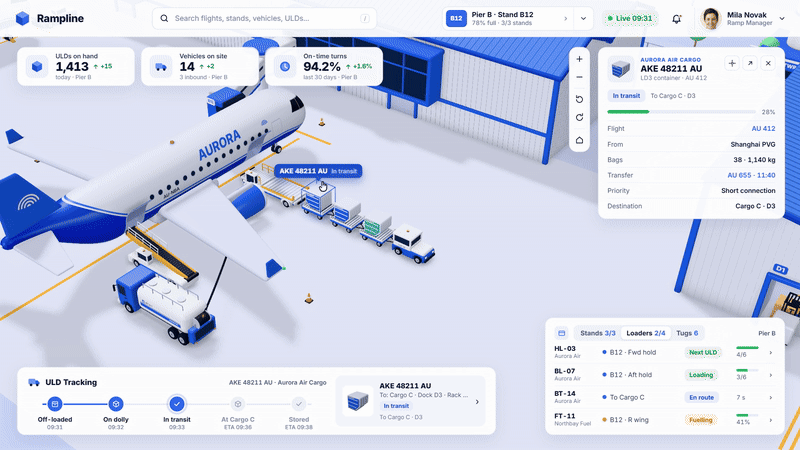
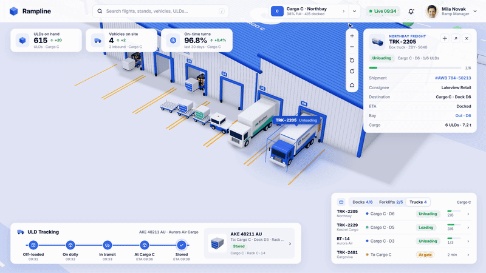

# simulator

A Claude Code skill that rebuilds any industry as a live simulator, in the format of a simulator video that already
worked.

Point it at a reference video. Claude takes it apart into rules (the camera, the scale, the palette, the interface,
the selection marks), splits the models between 2 subagents with one brief, and builds your system to those rules as
one offline HTML page: a toy-scale isometric map where every vehicle works on one clock, one item followed from the
first second to the last, a product UI over the map, one camera that only pans and zooms. Then it sweeps the whole
film for collisions and records it frame by frame into a 60 fps video with sound on every action.



## Install

```
npx skills add Nyxera0x/simulator -g -a claude-code
```

Then, once, in the installed folder:

```
npm install && npx playwright install chromium
```

You need Node.js 20 or newer. For the video you also need `ffmpeg`, and for the sound Python 3. An ElevenLabs key is
optional: without it the film carries the action sounds and the ambience.

## Use

Type `/simulator` in Claude Code, or ask in plain words:

> Take this simulator video apart and rebuild a container port in its format. Follow one box from the ship to the stack.

> Build a car plant as a live simulator in the airport's style: one body from the press to the truck, 50 seconds.

> Make a robot warehouse simulator. Follow one order from the shelf to the truck.

Or open the example first:

```
node sims/build.mjs airport-film        # simulator-out/dist/airport-film.html
```



## What is inside

| | |
|---|---|
| `SKILL.md` | What Claude reads: taking a reference apart, the brief, the light, the UI overlay, the day as a function of time, the camera, the collision sweep, sound and render. |
| `docs/BRIEF.md` | The brief the 2 model subagents worked from, as a template. |
| `sims/airport-shared/` | Rampline: a jet in 2 liveries, a pier with jet bridges, a cargo terminal, 15 ground vehicles, the product UI, the selection marks, the director, the score. |
| `sims/airport-film/` | The film's entry point and its timeline. |
| `sims/airport-collide/` | The collision sweep: every 0.1 s, every pair of bodies. |
| `sims/airport-look/` | A free camera on the world for close-up checks. |
| `sims/kit/` | Runtime and stage helpers. |
| `sims/build.mjs` | Bundles a system into one HTML file, three.js and fonts inlined. |
| `sims/capture.mjs` | Renders the film frame by frame to a 60 fps mp4, or review sheets of stills. |
| `sfx/`, `run_sfx.py` | Procedural sound on the film's timeline, mastered to -14 LUFS. |
| `tools/music.py` | The final mix: an ElevenLabs track (optional), the action sounds, real ambience. |
| `tools/sfx_fetch.py` | Real CC0 recordings from Openverse for the ambience, with credits. |

Every model is code. There is no 3D file and nothing to download.

## License

MIT
